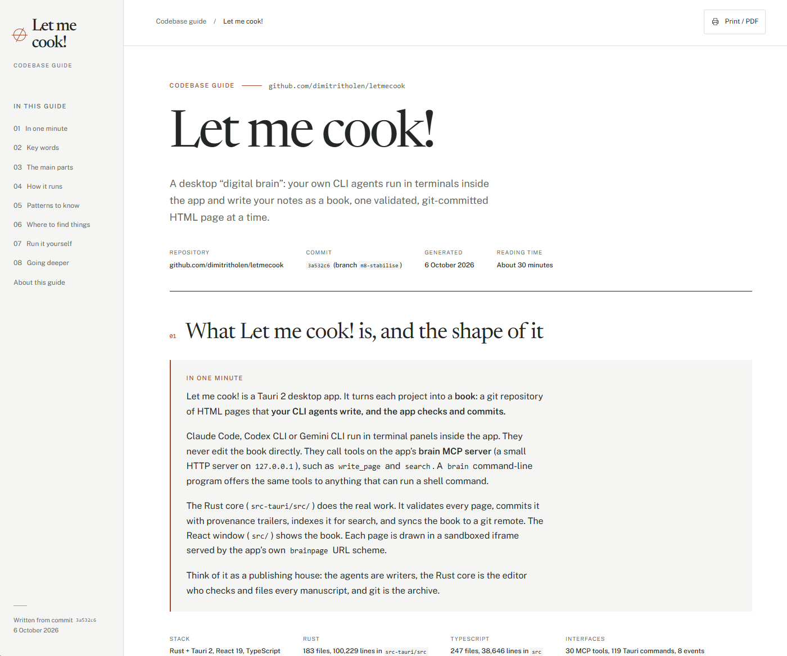
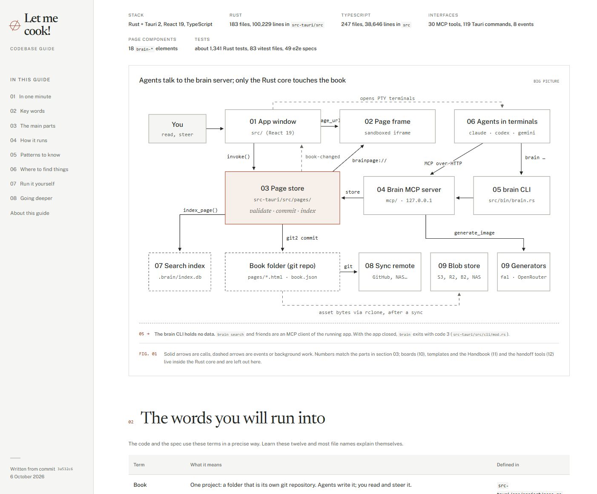
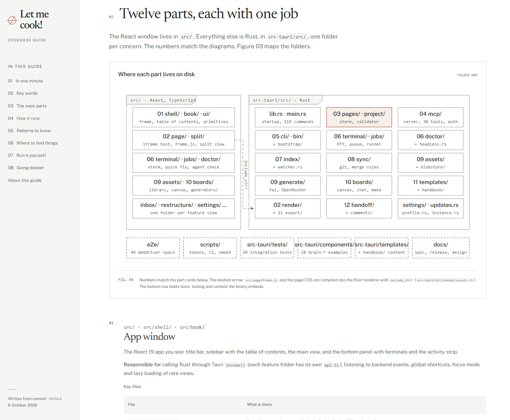
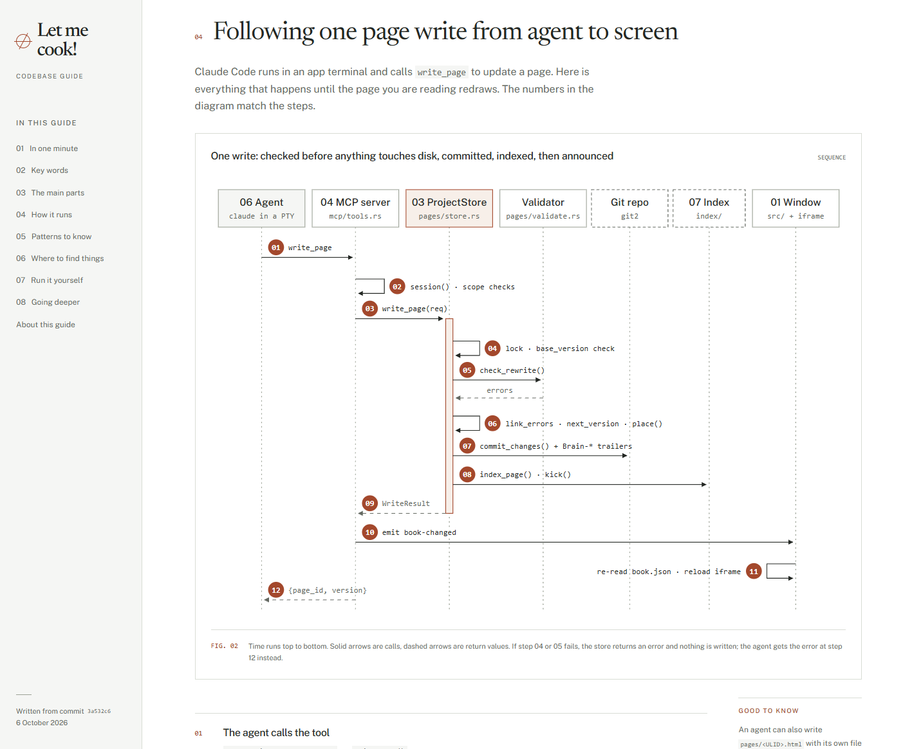
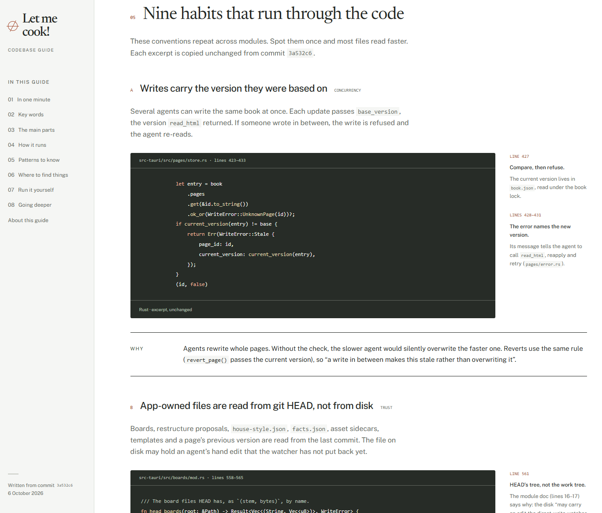
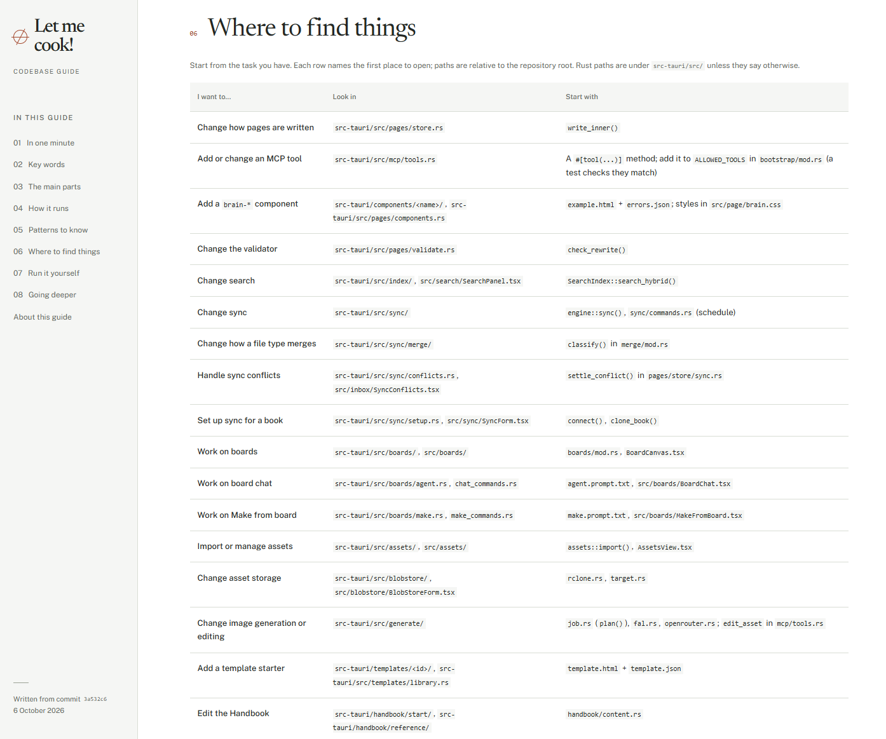

# codebase-guide

**Point Claude at a repo and get back the onboarding doc nobody ever had time
to write.**

One command reads your codebase and writes a single HTML file that explains
it: what the project does, which parts it is made of, how one real request
moves through the code, and which file to open for any change you want to
make. The diagrams are drawn from the actual code, every path and function
name in it exists, and the file opens offline in any browser.



<sub>Every screenshot on this page comes from one guide, written for Let me
cook!, a Tauri and React desktop app with almost 140,000 lines of Rust and
TypeScript.</sub>

## Why you'll want it

- **Newcomers get it on the first read.** The guide opens with the project in
  a few plain sentences, defines the jargon, and shows the whole system in
  one diagram.
- **Old hands find any file in minutes.** A "where to find things" table maps
  every feature and common task to the file and function to open first.
- **It only says what the code says.** Code excerpts are copied with their
  real line numbers, the guide records the commit it was written from, and
  anything unclear or apparently unused is flagged instead of guessed.
- **One file, nothing to host.** Fonts, styles and diagrams are embedded.
  Commit it to `docs/`, send it to a new hire, or print it to PDF.

## What a guide looks like

Every guide has the same eight sections: a one-minute overview, key words,
the main parts, one real run traced step by step, patterns to know, where to
find things, how to run it yourself, and collapsible notes for going deeper.

### The whole system in one picture

Each box is a real part of the codebase, labelled with the folder it lives
in. Solid arrows are calls, dashed ones are events.



### Where each part lives on disk

A folder map ties every component to its directory, with numbers that match
the part cards further down.



### One real run, step by step

A sequence diagram follows a single request through the actual functions.
The numbered steps under it name the file and function for each arrow.



### The habits of the codebase

Recurring conventions get a real excerpt, the line range it came from, and
the reason it is done that way.



### Where to find things

Start from the task you have, and the table tells you where to look and
which function to start with.



## Install

```bash
claude plugin marketplace add dimitritholen/codebase-guide
claude plugin install codebase-guide@codebase-guide
```

## Use

```
/codebase-guide:codebase-guide
```

The short form `/codebase-guide` works too, as long as no other installed
plugin has a skill with the same name.

Or ask for a codebase guide, an onboarding doc, an architecture overview, or
"explain this repo". The guide is written to `docs/codebase-guide.html`
unless you name another path, and no other file is edited.

## Settings

- `design_system` (meridian/builtin, default meridian): the look of the
  guide. `meridian` is an editorial design system with embedded fonts;
  `builtin` uses the skill's own template. Change it in `/config`, or for one
  shell with `CODEBASE_GUIDE_DESIGN_SYSTEM`.

See [design-systems/README.md](design-systems/README.md) for the contract a
new design system has to meet.

## Requirements

- `python3` to resolve the design-system setting.
- `node` to export a design-system draft into one offline HTML file (not
  needed for `builtin`).

## Tests

No keys or network needed:

```bash
for t in tests/*.test.sh; do bash "$t"; done
```

## Licenses

The bundled Newsreader and Public Sans fonts are under the SIL Open Font
License; the notices sit next to the font files in
`design-systems/meridian/assets/fonts/` and are embedded in every exported
guide.
